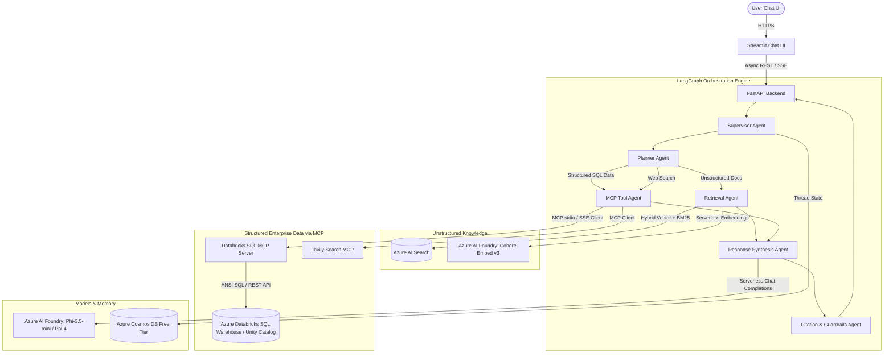
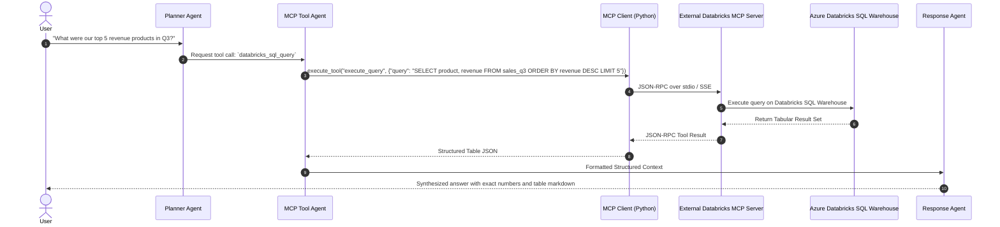

# Enterprise Agentic RAG Platform — Azure AI Foundry & Databricks MCP Edition

---

## 1. Architecture Overview (RAG + Databricks SQL via MCP)

The platform supports hybrid knowledge retrieval:
- **Unstructured Knowledge (100k+ docs)**: Azure AI Search with Foundry embeddings (`Cohere-embed-v3-english` / `text-embedding-3-small`).
- **Structured Enterprise Data (Tables & Lakehouse)**: **Azure Databricks (Databricks SQL Warehouse / Unity Catalog)** accessed through the **SQL MCP Tool Client**.
- **Real-Time Web Search**: **Tavily Search MCP Client**.
- **LLM Reasoning & Generation**: **Azure AI Foundry (Phi-3.5-mini / Phi-4 / Llama 3.1)**.
- **Session Memory**: **Azure Cosmos DB Free Tier** (1,000 RU/s + 25GB free forever).



---

## 2. How Azure Databricks Connects via MCP

### 2.1 Architecture Principles
As specified in the system design:
- **No custom MCP server maintenance**: We implement the **MCP Client** inside the backend.
- **External Databricks MCP Server**: Uses the official/standard Databricks SQL MCP server or generic SQL MCP server.
- **Security**: Authenticated via Databricks Personal Access Token (PAT) or Azure Managed Identity / Azure AD OAuth.



---

## 3. Databricks MCP Client Implementation in Python

The FastAPI backend instantiates an async MCP client that communicates with the Databricks MCP server:

```python
import os
from typing import Dict, Any, List
from mcp import ClientSession, StdioServerParameters
from mcp.client.stdio import stdio_client

class DatabricksMCPClient:
    """Async MCP Client connecting to external Databricks SQL MCP Server."""

    def __init__(self):
        self.server_params = StdioServerParameters(
            command="uvx",
            args=["mcp-server-databricks"], # Or generic sql mcp server
            env={
                "DATABRICKS_HOST": os.getenv("DATABRICKS_SERVER_HOSTNAME", ""),
                "DATABRICKS_HTTP_PATH": os.getenv("DATABRICKS_HTTP_PATH", ""),
                "DATABRICKS_TOKEN": os.getenv("DATABRICKS_TOKEN", ""),
            }
        )

    async def list_available_tools(self) -> List[Dict[str, Any]]:
        async with stdio_client(self.server_params) as (read, write):
            async with ClientSession(read, write) as session:
                await session.initialize()
                tools = await session.list_tools()
                return [{"name": tool.name, "description": tool.description, "schema": tool.inputSchema} for tool in tools.tools]

    async def execute_query(self, query: str) -> str:
        """Executes SQL query against Databricks SQL warehouse through MCP."""
        async with stdio_client(self.server_params) as (read, write):
            async with ClientSession(read, write) as session:
                await session.initialize()
                result = await session.call_tool("execute_sql", arguments={"query": query})
                return "\n".join([content.text for content in result.content if content.type == "text"])
```

---

## 4. Azure Databricks Connection Configuration

To connect Azure Databricks to the SQL MCP tool, obtain these three parameters from the **Azure Databricks Workspace**:

1. **Databricks Server Hostname**:
   - In Databricks Workspace -> **SQL Warehouses** -> Click your warehouse -> **Connection Details** -> Copy `Server Hostname` (e.g., `adb-123456789.azuredatabricks.net`).
2. **HTTP Path**:
   - In the same Connection Details tab -> Copy `HTTP Path` (e.g., `/sql/1.0/warehouses/a1b2c3d4e5f6`).
3. **Personal Access Token (PAT) / Azure AD Token**:
   - In Databricks Workspace -> User Profile -> **Settings** -> **Developer** -> **Access tokens** -> Generate Token.

---

## 5. Free / Minimal-Cost Azure Stack with Databricks

| Component | Service | SKU / Configuration | Cost Strategy |
| :--- | :--- | :--- | :--- |
| **Chat LLM** | Azure AI Foundry | `Phi-3.5-mini-instruct` / `Phi-4` (Serverless) | Pay-per-token / Free trial credits |
| **Embeddings** | Azure AI Foundry | `Cohere-embed-v3-english` (Serverless) | Pay-per-token / Free trial credits |
| **Structured SQL Tables** | Azure Databricks | Databricks SQL Warehouse (Serverless / 2X-Small) | Auto-stop enabled (stops after 10 min idle) |
| **Unstructured Search** | Azure AI Search | Free Tier / Basic | $0 for Free Tier (dev/pilot) |
| **Chat Memory** | Azure Cosmos DB | Free Tier (1,000 RU/s + 25GB) | **$0.00 Free Forever** |
| **Container Hosting** | Azure Container Apps | Consumption Plan (`minReplicas: 0`) | **$0.00** with 2M free requests/month |

---

## 6. Step-by-Step Setup & Provisioning

```powershell
$RG_NAME = "rg-chatbot-foundry"
$LOCATION = "eastus2"

# 1. Resource Group
az group create --name $RG_NAME --location $LOCATION

# 2. Cosmos DB Free Tier
az cosmosdb create `
  --name "cosmos-rag-freetier" `
  --resource-group $RG_NAME `
  --enable-free-tier true `
  --default-consistency-level "Session"

# Database & Container
az cosmosdb sql database create --account-name "cosmos-rag-freetier" --resource-group $RG_NAME --name "enterprise_rag_db"
az cosmosdb sql container create --account-name "cosmos-rag-freetier" --resource-group $RG_NAME --database-name "enterprise_rag_db" --name "conversations" --partition-key-path "/userId"

# 3. Azure Container Apps Environment (Scale to Zero)
az containerapp env create --name "aca-env-freetier" --resource-group $RG_NAME --location $LOCATION

# 4. Key Vault for Secrets (Databricks Token, Foundry Keys)
az keyvault create --name "kv-rag-freetier" --resource-group $RG_NAME --location $LOCATION --enable-rbac-authorization true
```
