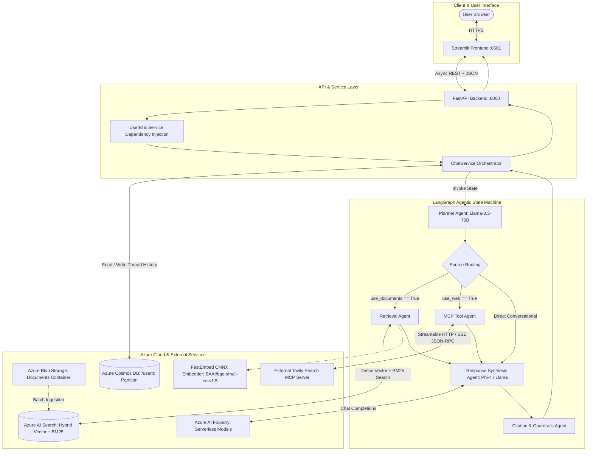
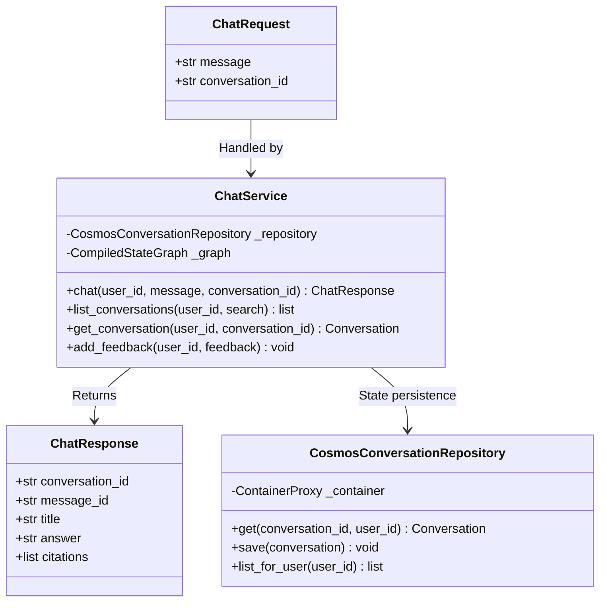
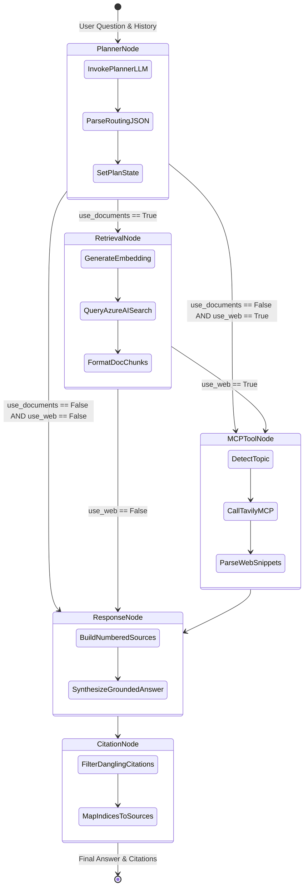
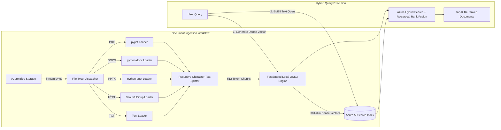
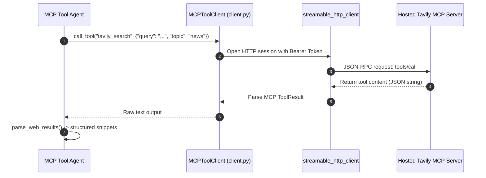
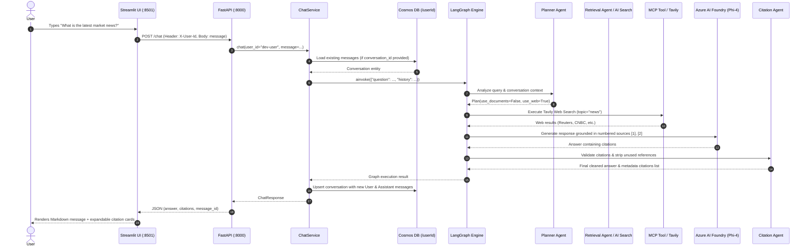
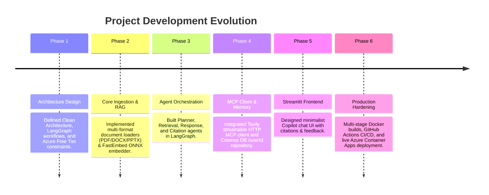
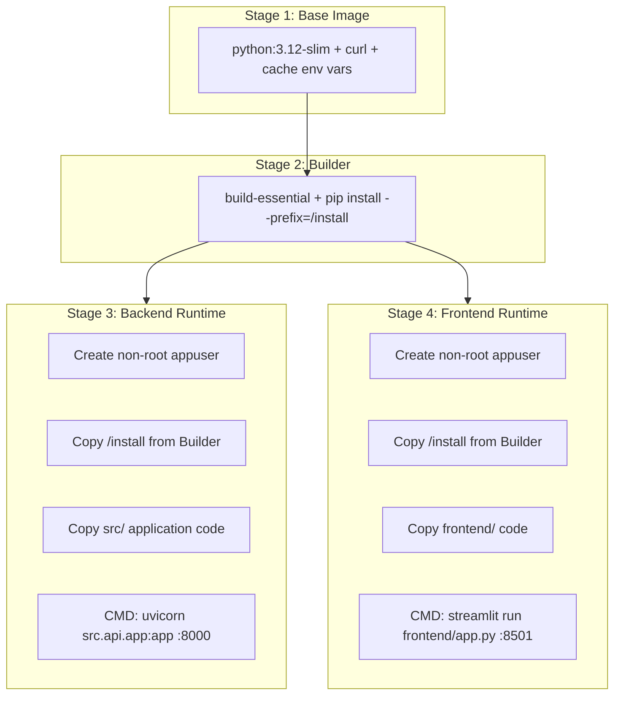

# Enterprise Agentic RAG Platform: Complete Architecture, Development & Deployment Guide

---

## Table of Contents
1. [Executive Summary & Problem Statement](#1-executive-summary--problem-statement)
2. [End-to-End System Architecture](#2-end-to-end-system-architecture)
3. [Clean Architecture & Code Map](#3-clean-architecture--code-map)
4. [Component-by-Component Deep Dive](#4-component-by-component-deep-dive)
   - [4.1 API & Service Layer (FastAPI & ChatService)](#41-api--service-layer-fastapi--chatservice)
   - [4.2 Agentic Workflow (LangGraph Engine)](#42-agentic-workflow-langgraph-engine)
   - [4.3 Knowledge Ingestion & Hybrid RAG (Azure AI Search + FastEmbed)](#43-knowledge-ingestion--hybrid-rag-azure-ai-search--fastembed)
   - [4.4 Tool Execution via MCP (Tavily Web Search)](#44-tool-execution-via-mcp-tavily-web-search)
   - [4.5 Memory & Session State (Azure Cosmos DB)](#45-memory--session-state-azure-cosmos-db)
   - [4.6 User Interface (Streamlit Modern Copilot)](#46-user-interface-streamlit-modern-copilot)
5. [End-to-End Execution Flow & Sequence Diagrams](#5-end-to-end-execution-flow--sequence-diagrams)
6. [Development Chronology: What, Why & How We Built It](#6-development-chronology-what-why--how-we-built-it)
7. [Troubleshooting & Bug Fixes Resolved in Production](#7-troubleshooting--bug-fixes-resolved-in-production)
8. [Containerization & CI/CD Pipelines](#8-containerization--cicd-pipelines)
9. [Live Production Deployment & Verification](#9-live-production-deployment--verification)

---

## 1. Executive Summary & Problem Statement

### 1.1 Business Objective
The goal is to build an enterprise-grade conversational AI platform capable of answering questions from a knowledge base containing **100,000+ unstructured documents** (PDFs, DOCX, PPTX, HTML, TXT) and retrieving **real-time public web intelligence**, while maintaining conversational history per user.

### 1.2 UX Constraints
- **Strictly Minimalist UX**: End users see only a clean chat interface (resembling ChatGPT, Microsoft Copilot, or Claude) with:
  1. Chat area with Markdown formatting and source citations.
  2. Sidebar for "+ New Chat" and searchable previous threads.
  3. Feedback controls (👍/👎).
- **Zero Administrative Clutter**: No document upload pages, no configuration forms, and no admin dashboards exposed to end users.

---

## 2. End-to-End System Architecture



---

## 3. Clean Architecture & Code Map

The project strictly follows **Clean Architecture** and **Domain-Driven Design (DDD)** principles. Business logic never depends on external database drivers or HTTP frameworks.

```text
├── .github/workflows/
│   ├── ci.yml                     # Continuous Integration: Pytest & Trivy security scanning
│   ├── cd.yml                     # Manual Azure Container Apps deployment pipeline
│   └── docker-hub-publish.yml     # Automated Docker Hub multi-stage build & push
├── frontend/
│   └── app.py                     # Streamlit Copilot UI (ChatGPT-style interface)
├── scripts/
│   ├── ingest_blobs.py            # Blob Storage -> Loaders -> FastEmbed -> AI Search indexer
│   ├── show_retrieved.py          # Debug CLI tool to view retrieved chunks and relevance scores
│   ├── try_graph.py               # Manual CLI test runner for full LangGraph pipeline
│   ├── try_mcp.py                 # Manual CLI check for MCP client & Tavily connectivity
│   └── try_rag.py                 # Manual CLI check for hybrid search queries
├── src/
│   ├── agents/
│   │   ├── citation.py            # Post-processes answer, validates [1] references against sources
│   │   ├── mcp_tool.py            # Invokes web search tools and parses structured results
│   │   ├── planner.py             # LLM router deciding whether to search documents, web, or neither
│   │   ├── response.py            # Synthesizes grounded answer from numbered context snippets
│   │   └── retrieval.py           # Executes hybrid vector + text search over Azure AI Search
│   ├── api/
│   │   ├── app.py                 # FastAPI application factory, lifespan, CORS & dependency setup
│   │   ├── dependencies.py        # Dependency injection for ChatService and UserId extraction
│   │   └── routes.py              # REST HTTP handlers (/chat, /conversations, /feedback, /health)
│   ├── core/
│   │   └── config.py              # Pydantic Settings reading typed environment variables from .env
│   ├── domain/
│   │   ├── conversation.py        # Pure domain models: Conversation, Message, ConversationSummary
│   │   └── plan.py                # Pure domain models: Plan, Citation
│   ├── graph/
│   │   ├── builder.py             # Compiles LangGraph StateGraph with conditional edges
│   │   └── state.py               # TypedDict defining ChatState flowing through all nodes
│   ├── infrastructure/
│   │   ├── cosmos.py              # Async CosmosClient and ContainerProxy factory
│   │   └── llm.py                 # LangChain AzureChatOpenAI and Azure AI Foundry model factories
│   ├── mcp/
│   │   ├── client.py              # Streamable HTTP MCP Client (client-side only, with retries)
│   │   └── tavily.py              # Tavily MCP adapter with dynamic topic detection (news vs general)
│   ├── memory/
│   │   └── repository.py          # Cosmos DB repository partitioned by /userId
│   ├── models/
│   │   └── api.py                 # Pydantic request & response schemas for HTTP endpoints
│   ├── rag/
│   │   ├── blob_source.py         # Async iterator streaming files from Azure Blob Storage
│   │   ├── embedder.py            # Zero-cost local ONNX text embedder (FastEmbed)
│   │   ├── index.py               # Azure AI Search index schema creator (HNSW + Semantic config)
│   │   ├── ingest.py              # Recursive text splitting & batch vector upload
│   │   ├── loaders.py             # Multi-format document loaders (PDF, DOCX, PPTX, TXT, HTML)
│   │   └── retriever.py           # Hybrid retriever combining dense vectors and text queries
│   └── services/
│       └── chat_service.py        # Application service orchestrating graph runs and Cosmos persistence
├── tests/
│   ├── conftest.py                # Pytest fixtures and mock environment setup
│   ├── test_api_endpoints.py      # HTTP route tests with mocked services
│   ├── test_citation_agent.py     # Citation validation and fallback tests
│   ├── test_domain.py             # Domain model serialization tests
│   ├── test_loaders.py            # File format parsing tests
│   └── test_planner.py            # Intent routing and prompt tests
├── Dockerfile                     # Multi-stage production build (backend & frontend targets)
├── docker-compose.yml             # Local dual-container orchestration
├── pyproject.toml                 # Pytest configuration & project metadata
├── requirements.txt               # Locked production dependencies
└── test_azure_connections.py      # Pre-flight diagnostic script for Azure cloud credentials
```

---

## 4. Component-by-Component Deep Dive

### 4.1 API & Service Layer (`src/api/` & `src/services/`)

#### Purpose
Exposes an asynchronous, non-blocking HTTP REST interface.



#### Key Implementation Details:
1. **Dependency Injection ([`src/api/dependencies.py`](src/api/dependencies.py:1))**:
   - `UserIdDep`: Reads `X-User-Id` header (defaults to `dev-user`). In enterprise production, this decodes verified Azure AD / Entra ID JWT claims.
   - `ChatServiceDep`: Injects the singleton `ChatService` stored on `app.state`.
2. **Defensive Session Loading ([`src/services/chat_service.py`](src/services/chat_service.py:103))**:
   - `_load_or_start(user_id, conversation_id)`: Safely detects if `conversation_id` is empty, whitespace, or omitted, instantly creating a fresh `Conversation` without querying Cosmos DB for non-existent IDs.

---

### 4.2 Agentic Workflow (LangGraph Engine)

The core reasoning logic is modeled as a compiled **LangGraph StateGraph**.



#### The 5 Specialized Agents:
1. **Planner Agent ([`src/agents/planner.py`](src/agents/planner.py:1))**:
   - Analyzes user input and the last 6 conversation turns.
   - Generates a strict structured JSON plan: `{"use_documents": bool, "use_web": bool}`.
   - Built with fallback handling: if the LLM output is malformed, it defaults to document search.
2. **Retrieval Agent ([`src/agents/retrieval.py`](src/agents/retrieval.py:1))**:
   - Executes hybrid vector + text search against Azure AI Search, extracting the top $k$ relevant chunks.
3. **MCP Tool Agent ([`src/agents/mcp_tool.py`](src/agents/mcp_tool.py:1))**:
   - Connects to Tavily Search via streamable HTTP MCP.
   - Automatically detects topics (`news` vs `general`) and parses live web snippets.
4. **Response Agent ([`src/agents/response.py`](src/agents/response.py:1))**:
   - Constructs a unified, numbered context list (`[1]`, `[2]`, `[3]`).
   - Enforces grounding: instructs the LLM to only state facts present in the numbered sources.
5. **Citation Agent ([`src/agents/citation.py`](src/agents/citation.py:1))**:
   - Regex-parses `[n]` bracket notations from the final answer.
   - Strips citations pointing to non-existent sources (hallucination guardrail).
   - Filters the returned citations metadata to include **only** sources cited in the final text.

---

### 4.3 Knowledge Ingestion & Hybrid RAG



#### Why FastEmbed Local ONNX Embeddings?
- **Zero Cost**: Runs locally on CPU inside the container using ONNX Runtime.
- **High Performance**: Model `BAAI/bge-small-en-v1.5` outputs 384-dimensional dense vectors with sub-20ms latency per query.
- **No Rate Limits**: Bypasses external embedding API rate limits during bulk document ingestion.

---

### 4.4 Tool Execution via MCP (Model Context Protocol)

We follow the standard MCP specification using client-side communication over streamable HTTP.



---

### 4.5 Memory & Session State (Cosmos DB)

- **Container Partition Key**: `/userId`
- **Cost**: **$0.00** using Azure Cosmos DB Free Tier (1,000 RU/s + 25GB storage free forever).
- **Partition Isolation**: Every query (`read_item`, `upsert_item`, `query_items`) passes the partition key `user_id`. Queries execute in $< 5\text{ms}$ within a single logical partition.

---

## 5. End-to-End Execution Flow & Sequence Diagrams

Here is what happens when a user types a query in the frontend:



---

## 6. Development Chronology: What, Why & How We Built It



---

## 7. Troubleshooting & Bug Fixes Resolved in Production

During the development and cloud deployment lifecycle, several real-world enterprise issues were diagnosed and resolved:

### Issue 1: Cosmos DB Authorization 401 on Swagger UI Defaults
- **Symptom**: `CosmosHttpResponseError: (Unauthorized) The input authorization token can't serve the request`.
- **Root Cause**: When testing `POST /chat` on Swagger UI, the default schema payload included a placeholder `"conversation_id": "string"`. The service attempted to look up this dummy ID in Cosmos DB.
- **Fix**: Updated [`_load_or_start`](src/services/chat_service.py:103) in `chat_service.py` to defensively check `if not conversation_id or not conversation_id.strip():` and instantiate a fresh `Conversation` without querying Cosmos DB.

### Issue 2: Tavily Search Returning Cached Repository Metadata
- **Symptom**: Queries like *"what is latest indian market news"* returned irrelevant GitHub `proxy.py` links.
- **Root Cause**: Tavily's default MCP parameters used `search_depth="basic"` and `topic=None`, falling back to general shallow crawl indices.
- **Fix**: Added dynamic topic detection in [`src/mcp/tavily.py`](src/mcp/tavily.py:18). Whenever queries mention terms like `news`, `latest`, `today`, `market`, `stocks`, `headline`, it automatically assigns `topic="news"` and `search_depth="advanced"`.

### Issue 3: Container Non-Root Permission Denied for HuggingFace/FastEmbed Cache
- **Symptom**: Container crashed on startup in Azure Container Apps with `Permission denied (os error 13): Could not download model ... to /app/.cache`.
- **Root Cause**: The security non-root user `appuser` did not have write permissions to the default root-owned `/app/.cache` directory.
- **Fix**: Updated [`Dockerfile`](Dockerfile:10) to set `ENV HF_HOME=/tmp/cache/huggingface` and `ENV FASTEMBED_CACHE_PATH=/tmp/cache/fastembed`, creating and `chown`-ing `/tmp/cache` to `appuser:appgroup`.

### Issue 4: Azure AI Foundry Chat Endpoint Path Duplication
- **Symptom**: Live backend container returned `502 Bad Gateway` with logs showing `404 Resource Not Found` on `.../openai/v1/chat/completions/chat/completions`.
- **Root Cause**: The OpenAI SDK automatically appends `/chat/completions` to the base endpoint. The Azure Container App had been configured with the full subpath.
- **Fix**: Updated the container app's environment variable `AZURE_AI_FOUNDRY_CHAT_ENDPOINT` to `https://ai-chatbot-2112.services.ai.azure.com/models`.

---

## 8. Containerization & CI/CD Pipelines

### 8.1 Multi-Stage Production Dockerfile (`Dockerfile`)



### 8.2 GitHub Actions Workflows
1. **`.github/workflows/ci.yml`**: Triggers on PR/push to `main`. Runs `pytest` test suite (17 tests) and **Trivy filesystem vulnerability scanning**.
2. **`.github/workflows/docker-hub-publish.yml`**: Automatically builds and pushes:
   - `tadevilas/agentic-bot-azure-backend:latest`
   - `tadevilas/agentic-bot-azure-frontend:latest`

---

## 9. Live Production Deployment & Verification

### 9.1 Deployed Services on Azure Container Apps (East US)

| Service | Container App Name | Image | Port | Live Public URL |
| :--- | :--- | :--- | :---: | :--- |
| **Streamlit UI** | `aca-rag-frontend` | `tadevilas/agentic-bot-azure-frontend:latest` | `8501` | [https://aca-rag-frontend.salmonriver-feff8fb1.eastus.azurecontainerapps.io/](https://aca-rag-frontend.salmonriver-feff8fb1.eastus.azurecontainerapps.io/) |
| **FastAPI Backend** | `aca-rag-backend` | `tadevilas/agentic-bot-azure-backend:latest` | `8000` | [https://aca-rag-backend.salmonriver-feff8fb1.eastus.azurecontainerapps.io/docs](https://aca-rag-backend.salmonriver-feff8fb1.eastus.azurecontainerapps.io/docs) |

### 9.2 Verification Commands

```powershell
# Check Backend Health
curl https://aca-rag-backend.salmonriver-feff8fb1.eastus.azurecontainerapps.io/health

# Check Frontend Health
curl https://aca-rag-frontend.salmonriver-feff8fb1.eastus.azurecontainerapps.io/_stcore/health

# Run automated test suite locally
uv run pytest -v
```
