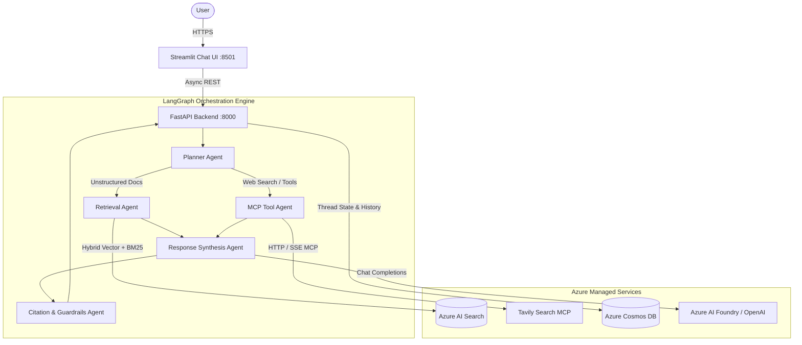

# Enterprise Agentic RAG Platform

Production-ready, multi-agent conversational AI platform built with **Azure AI Foundry**, **LangGraph**, **FastAPI**, **Azure AI Search**, **Azure Cosmos DB**, and **Streamlit**.

---

## 1. System Architecture



---

## 2. Key Capabilities

- **Agentic Workflow with LangGraph**: Dynamic routing between knowledge retrieval, web search, and direct LLM synthesis.
- **Enterprise Hybrid Search**: Combines BM25 keyword matching with dense vector search (FastEmbed ONNX) over Azure AI Search.
- **Multi-Format Document Ingestion**: Ingests and parses `.pdf`, `.docx`, `.pptx`, `.txt`, and `.html` directly from Azure Blob Storage.
- **Model Context Protocol (MCP)**: Client-side integration for external tools (e.g. Tavily Search).
- **Persistent Conversational Memory**: Thread management, user history querying, and feedback tracking in Azure Cosmos DB.
- **Production-Grade UI**: Minimalist ChatGPT/Copilot-style Streamlit frontend with expandable citations and message ratings.
- **Containerized & Scalable**: Multi-stage Docker builds deployable to Azure Container Apps (scaling to zero).

---

## 3. Project Structure

```text
├── .github/workflows/          # CI/CD (Test, Security Scan, Docker Build, ACA Deploy)
├── frontend/
│   └── app.py                  # Streamlit Chat Interface
├── scripts/
│   ├── ingest_blobs.py         # Batch ingest from Blob Storage to AI Search
│   ├── show_retrieved.py       # Debug search relevance and chunks
│   ├── try_graph.py            # LangGraph multi-agent test runner
│   ├── try_mcp.py              # MCP tool invocation runner
│   └── try_rag.py              # Hybrid retrieval sanity check
├── src/
│   ├── agents/                 # LangGraph Agent implementations (Planner, Retrieval, Response, Citation)
│   ├── api/                    # FastAPI routes, dependencies, and lifecycle
│   ├── core/                   # Pydantic Settings configuration
│   ├── domain/                 # Domain entities (Conversation, Message, Plan, Citation)
│   ├── graph/                  # LangGraph State & Graph compilation
│   ├── infrastructure/         # Cosmos DB, LLM clients, Key Vault
│   ├── mcp/                    # Streamable HTTP MCP client & Tavily adapter
│   ├── memory/                 # Cosmos DB conversation repository
│   ├── models/                 # API request/response schemas
│   ├── rag/                    # Ingestion, loaders, embedder, index management, retriever
│   └── services/               # Chat orchestration service
├── tests/                      # Automated pytest unit and integration test suite
├── Dockerfile                  # Multi-stage production container build
├── docker-compose.yml          # Local multi-service orchestration
└── requirements.txt            # Python dependencies
```

---

## 4. Getting Started

### 4.1 Prerequisites
- Python 3.12+
- `uv` or `pip`
- Azure Subscription (AI Search, Cosmos DB, AI Foundry / OpenAI, Blob Storage)

### 4.2 Configuration
Copy `.env.example` to `.env` and fill in your connection credentials:

```bash
cp .env.example .env
```

### 4.3 Running Locally

#### Run Backend API:
```bash
uv run uvicorn src.api.app:app --host 127.0.0.1 --port 8000 --reload
```
Swagger API docs available at `http://localhost:8000/docs`.

#### Run Frontend UI:
```bash
uv run streamlit run frontend/app.py
```
Access the Copilot interface at `http://localhost:8501`.

#### Run with Docker Compose:
```bash
docker compose up --build
```

---

## 5. Ingestion & Document Processing

To index documents stored in Azure Blob Storage:

```bash
uv run python -X utf8 -m scripts.ingest_blobs
```

---

## 6. Running Tests & Quality Checks

Run the automated test suite:

```bash
uv run pytest -v
```

---

## 7. CI/CD & Deployment

- **CI (`.github/workflows/ci.yml`)**: Automated pytest runs and Trivy security scanning on push and PR.
- **CD (`.github/workflows/cd.yml`)**: Builds and pushes Docker images to Azure Container Registry (ACR) and triggers rolling deployments on Azure Container Apps.
